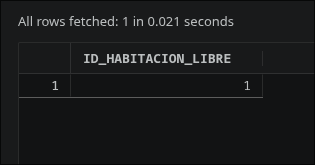
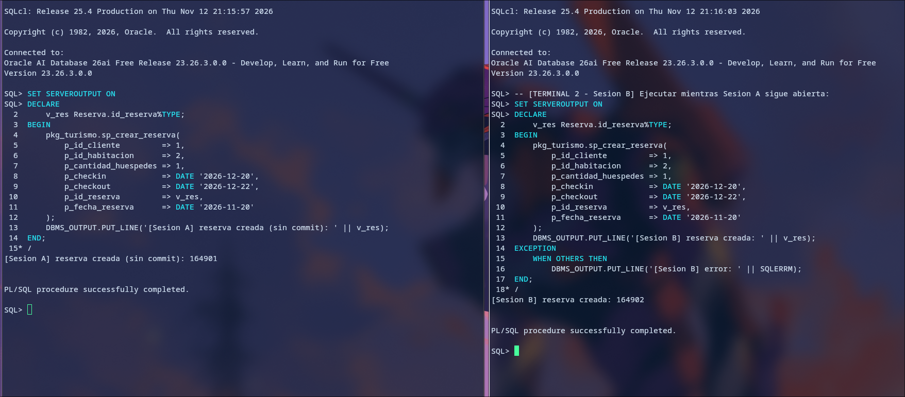
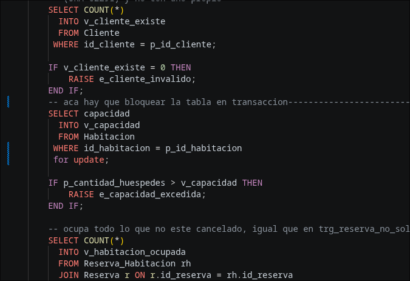
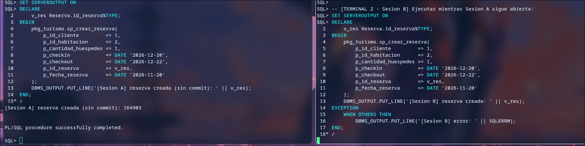

# Experimento de Concurrencia — TurismoUQ (Entrega 3)

## Objetivo
Demostrar qué ocurre cuando dos sesiones concurrentes intentan reservar la misma habitación para las mismas fechas y comparar el comportamiento del sistema antes y después de aplicar un bloqueo pesimista mediante la cláusula FOR UPDATE.

---

## 1. Preparación del experimento (Paso 0)

Con el `AUTOCOMMIT` desactivado, que es el comportamiento por defecto en SQLcl y Oracle, y teniendo en cuenta que el procedimiento `pkg_turismo.sp_crear_reserva` no ejecuta `COMMIT` por sí mismo, se conectaron dos sesiones simultáneas al esquema `proyecto` (`sql proyecto/furry@//localhost:1521/FREEPDB1`).

Primero se consultó un cliente existente y una habitación disponible para el rango del `2026-12-20` al `2026-12-22`:

```sql
SELECT MIN(id_cliente) AS id_cliente FROM Cliente;

SELECT MIN(h.id_habitacion) AS id_habitacion_libre
  FROM Habitacion h
 WHERE h.id_habitacion NOT IN (
       SELECT rh.id_habitacion
         FROM Reserva_Habitacion rh
         JOIN Reserva r ON r.id_reserva = rh.id_reserva
        WHERE r.estado <> 'cancelada'
          AND rh.checkin  < DATE '2026-12-22'
          AND rh.checkout > DATE '2026-12-20'
 );
```

### Evidencia del Paso 0



---

## 2. Caso 1 (ANTES): Sin bloqueo pesimista

Se ejecutó el bloque de reserva para el cliente `1` y la habitación `2` (fechas `2026-12-20` a `2026-12-22`) en la Terminal 1 (Sesión A) sin hacer `COMMIT`, e inmediatamente se ejecutó el mismo bloque en la Terminal 2 (Sesión B).

Como Oracle trabaja por defecto con el nivel de aislamiento `READ COMMITTED`, la Sesión B no ve las filas aún no confirmadas de la Sesión A. En consecuencia, ambas sesiones validaron la disponibilidad como libre y lograron insertar una reserva con los mismos datos (`164901` y `164902`) sin bloquearse:



Problema observado: si ambas sesiones confirman con `COMMIT`, se produce una doble reserva sobre la misma habitación y las mismas fechas.

Tras capturar la evidencia, se ejecutó `ROLLBACK;` en ambas terminales para limpiar las transacciones abiertas.

---

## 3. Solución aplicada: bloqueo de la habitación

Para evitar que dos transacciones evalúen la disponibilidad de una misma habitación al mismo tiempo, se agregó la cláusula FOR UPDATE a la consulta de `Habitacion` dentro de `pkg_turismo.sp_crear_reserva` (`entrega2/01_paquete.sql`). El bloqueo se adquiere antes de consultar la disponibilidad e insertar en `Reserva_Habitacion`:

```sql
SELECT capacidad
  INTO v_capacidad
  FROM Habitacion
 WHERE id_habitacion = p_id_habitacion
   FOR UPDATE;
```



---

## 4. Caso 2 (DESPUÉS): Con bloqueo pesimista

Se repitió exactamente el mismo experimento en ambas terminales tras recompilar el paquete `pkg_turismo`:

1. La Terminal 1 (Sesión A) ejecutó la reserva sin hacer `COMMIT`, adquiriendo el bloqueo exclusivo sobre la fila de la habitación `2` en `Habitacion`.
2. La Terminal 2 (Sesión B) intentó ejecutar el mismo bloque y quedó bloqueada en espera hasta que la Sesión A confirmara su transacción.
3. Al ejecutar `COMMIT;` en la Terminal 1, la Terminal 2 se desbloqueó, leyó el estado ya confirmado de la base de datos y rechazó la segunda reserva con el error `ORA-20010: La habitacion no esta disponible para el rango indicado`.



---

## 5. Comparación Antes vs. Después

Antes de aplicar el bloqueo, la Sesión B se ejecuta inmediatamente sin esperar porque en el nivel de aislamiento `READ COMMITTED` no ve la reserva aún sin confirmar de la Sesión A, permitiendo insertar dos reservas simultáneas (`164901` y `164902`) sobre la misma habitación y las mismas fechas.

Después de aplicar `SELECT ... FOR UPDATE` sobre la fila de la habitación, la Sesión B queda bloqueada esperando hasta que la Sesión A ejecute `COMMIT` o `ROLLBACK`. De esta manera, la Sesión B solo evalúa la disponibilidad cuando la Sesión A termina su transacción, garantizando una única reserva válida y rechazando limpiamente la segunda con el error `ORA-20010`.
